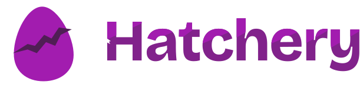
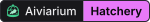

# Brand

The icons, wordmarks, lockups and badges of the organisation and its projects.
A project has one colour, which its icon, its wordmark and its badges use.

| Project | Colour on dark | Colour on light |
| --- | --- | --- |
| Aiviarium | `#3FCF8E` | `#12875A` |
| Rookery | `#F2B33D` | `#9A6200` |
| Parrot | `#FF6369` | `#D1343B` |
| Crow | `#8F8FFA` | `#4A4AC8` |
| Hatchery | `#E879F9` | `#A21CAF` |

## What is here

| Folder | Holds |
| --- | --- |
| `icons/` | Each icon in full detail, reduced for 24 to 48 px (`-icon`) and for 16 px (`-16`), each for dark and light (`-light`) backgrounds and in one colour (`-mono`) |
| `wordmarks/` | Each name as outlines, for dark and light backgrounds and in one colour |
| `lockups/` | Icon and wordmark together, side by side, stacked, and at text size (`-text`) with the reduced icon |
| `badges/` | The badges the projects use, made by `tools/badges.sh` |
| `fonts/` | Inter and Bricolage Grotesque with their licenses, which the tools read |
| `tools/` | `badge.py` draws one badge, and `badges.sh` writes the usual set |

## A name as an image

GitHub shows a README in its own typeface. Where a project's name should look
like its wordmark, use the lockup at text size. This one follows the reader's
theme and links to the repository:

```html
<a href="https://github.com/aiviarium/hatchery"><picture>
  <source media="(prefers-color-scheme: dark)" srcset="https://raw.githubusercontent.com/aiviarium/.github/main/brand/lockups/lockup-hatchery-text.svg">
  
</picture></a>
```

Use a height of 34 for a name in running text and 56 for the heading of a page.

## Badges

A badge has the project's icon and a label on a dark field. A value, when it
has one, is on the project's colour. One badge works on dark and light pages.

```bash
pip install fonttools brotli
brand/tools/badge.py hatchery license "MIT OR Apache-2.0" -o hatchery-license.svg
brand/tools/badge.py aiviarium Aiviarium Hatchery --value-colour hatchery -o hatchery-family.svg
```

| Badge | File | Use |
| --- | --- | --- |
| Name | `badges/<project>.svg` | Marks something as belonging to the project |
| Family | `badges/<project>-family.svg` | At the top of a project's README, linked to the organisation |
| State | `badges/<project>-state.svg` | On the organisation's page |
| License | `badges/<project>-license.svg` | At the top of a project's README |

In Markdown:

```markdown
[](https://github.com/aiviarium)
```

A badge whose value changes, such as a release or the state of CI, comes from
shields.io with the same colours. Set `labelColor=18181B` and `color=` to the
project's colour on dark, without the `#`:

```markdown

```
