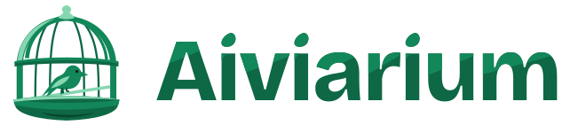
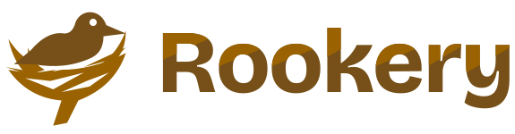
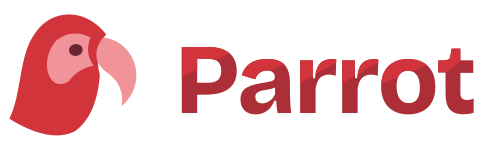
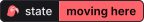
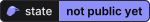
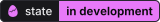

<h1><a href="https://github.com/aiviarium"><picture><source media="(prefers-color-scheme: dark)" srcset="https://raw.githubusercontent.com/aiviarium/.github/main/brand/lockups/lockup-aiviarium.svg"></picture></a></h1>

Tools for managing modern development workflows and modular software.

<a href="https://github.com/aiviarium"><picture><source media="(prefers-color-scheme: dark)" srcset="https://raw.githubusercontent.com/aiviarium/.github/main/brand/lockups/lockup-rookery-text.svg"></picture></a>

Provisioning and management for development machines. 

<a href="https://github.com/aiviarium"><picture><source media="(prefers-color-scheme: dark)" srcset="https://raw.githubusercontent.com/aiviarium/.github/main/brand/lockups/lockup-parrot-text.svg"></picture></a>

Adapters and automation for AI coding tools. 

<a href="https://github.com/aiviarium"><picture><source media="(prefers-color-scheme: dark)" srcset="https://raw.githubusercontent.com/aiviarium/.github/main/brand/lockups/lockup-crow-text.svg"></picture></a>

An application framework for a team's internal tools. 

<a href="https://github.com/aiviarium/hatchery"><picture><source media="(prefers-color-scheme: dark)" srcset="https://raw.githubusercontent.com/aiviarium/.github/main/brand/lockups/lockup-hatchery-text.svg"></picture></a>

Packaging and distribution for plugins and modular software. 
