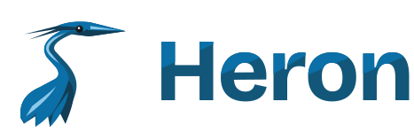
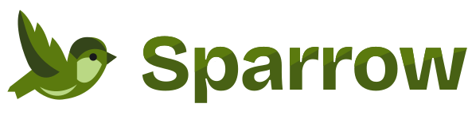

<h1><a href="https://github.com/aiviarium"><picture><source media="(prefers-color-scheme: dark)" srcset="https://raw.githubusercontent.com/aiviarium/.github/main/brand/lockups/lockup-aiviarium.svg"></picture></a></h1>

Tools for managing modern development workflows and modular software.

<table>
  <tr>
    <td width="230"><a href="https://github.com/aiviarium"><picture><source media="(prefers-color-scheme: dark)" srcset="https://raw.githubusercontent.com/aiviarium/.github/main/brand/lockups/lockup-rookery-text.svg"></picture></a></td>
    <td>Provisioning and management for development machines. </td>
  </tr>
  <tr>
    <td width="230"><a href="https://github.com/aiviarium"><picture><source media="(prefers-color-scheme: dark)" srcset="https://raw.githubusercontent.com/aiviarium/.github/main/brand/lockups/lockup-crow-text.svg"></picture></a></td>
    <td>An application framework for a team's internal tools. </td>
  </tr>
  <tr>
    <td width="230"><a href="https://github.com/aiviarium/heron"><picture><source media="(prefers-color-scheme: dark)" srcset="https://raw.githubusercontent.com/aiviarium/.github/main/brand/lockups/lockup-heron-text.svg"></picture></a></td>
    <td>A specification system. </td>
  </tr>
  <tr>
    <td width="230"><a href="https://github.com/aiviarium"><picture><source media="(prefers-color-scheme: dark)" srcset="https://raw.githubusercontent.com/aiviarium/.github/main/brand/lockups/lockup-sparrow-text.svg"></picture></a></td>
    <td>A binary RPC system. </td>
  </tr>
</table>
